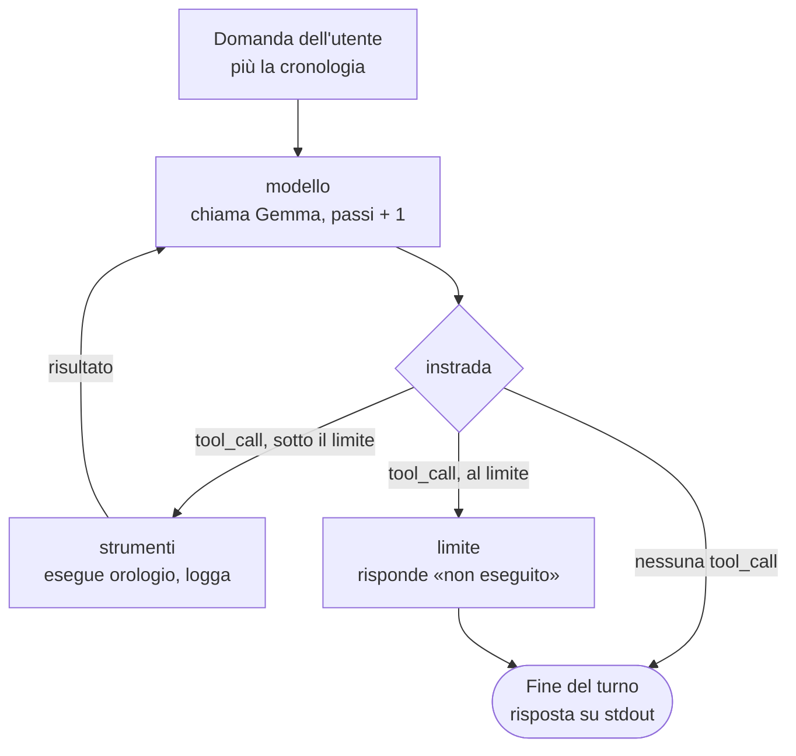

# Assistente del laboratorio — documento di progetto

2 novembre 2026 · Giuseppe Gangi

## Cosa ho realizzato

Ho realizzato un assistente da terminale in Python che conversa con il modello locale `google/gemma-4-e2b` servito da LM Studio. Sa dire l'ora di Roma o di qualsiasi altro paese chiedendo lo strumento `orologio`, che il programma esegue davvero. Funziona sia in locale sia con Docker Compose, e LM Studio resta sul computer host.

Il flusso è un grafo LangGraph scritto a mano: stato, nodi e instradamento si leggono nel codice. La cronologia resta in memoria per tutta la sessione e si perde alla chiusura. Le risposte vanno su stdout. Ogni chiamata allo strumento compare nei log su stderr, con nome, argomenti e risultato.

Esempio di sessione reale (in Docker, 2 novembre 2026):

```
tu> che ore sono?
[log] INFO assistente.grafo: passo 1: strumento orologio({"fuso_orario": "Europe/Rome"}) -> {"fuso_orario": "Europe/Rome", "data_ora": "2026-11-02T09:54:17+01:00", "giorno": "lunedì", "abbreviazione": "CET"}
assistente> Sono le 09:54:17 di lunedì, secondo il fuso orario Europe/Rome.
tu> e a Tokyo?
[log] INFO assistente.grafo: passo 1: strumento orologio({"fuso_orario": "Asia/Tokyo"}) -> {"fuso_orario": "Asia/Tokyo", "data_ora": "2026-11-02T17:54:45+09:00", "giorno": "lunedì", "abbreviazione": "JST"}
assistente> A Tokyo sono le 17:54:45 di lunedì, secondo il fuso orario Asia/Tokyo.
```

La seconda domanda («e a Tokyo?») funziona solo grazie alla cronologia: da sola non dice che si parla dell'ora.

Avvio con Docker: `docker compose build` e poi `docker compose run --rm assistente`. In locale: `.\.venv\Scripts\python -m assistente`. I dettagli sono nel README.

## Cosa chiedeva la consegna

La consegna fissava cosa costruire e con quale metodo; il resto del progetto sono scelte mie, descritte più avanti. Requisiti imposti:

- applicazione da terminale in Python, codice sincrono e moduli piccoli;
- flusso in un grafo LangGraph esplicito, con stato, nodi e instradamento riconoscibili;
- modello servito da LM Studio sull'host, raggiunto con l'API compatibile con OpenAI;
- cronologia conservata per la sola durata della sessione;
- strumento orologio con fuso orario esplicito, richiesto dal modello via tool calling ed eseguito davvero;
- avvio anche con Docker Compose, senza containerizzare LM Studio;
- indirizzo e id del modello solo da variabili d'ambiente (id letto da `GET /v1/models`), file di esempio senza credenziali;
- test ripetibili senza modello attivo, e prove reali con LM Studio e Docker tenute separate;
- metodo Superpowers: specifica e piano approvati prima del codice, incrementi piccoli e verificati;
- Conventional Commits in italiano, staging selettivo, nessun segreto in Git, push solo su richiesta;
- nessun altro strumento, MCP, RAG o interfaccia grafica.

In breve: lingua, framework, provider del modello e Docker erano imposti. Quasi tutto il "come" no.

## Architettura

Il codice è un pacchetto `assistente/` di sei moduli piccoli, e il cuore è il grafo in `grafo.py`.

| Modulo | Ruolo |
| --- | --- |
| `config.py` | legge e valida le variabili d'ambiente |
| `strumenti.py` | strumento `orologio` |
| `modello.py` | client `ChatOpenAI` verso LM Studio, controllo dei modelli serviti |
| `grafo.py` | stato, nodi e instradamento del grafo |
| `terminale.py` | ciclo di chat, cronologia di sessione, log |
| `__main__.py` | avvio con `python -m assistente` |

Lo stato del grafo ha due campi: `messages`, cioè la conversazione, e `passi`, le chiamate al modello per la domanda corrente.



Ogni domanda entra nel nodo `modello`. Se Gemma chiede l'orologio, il grafo passa da `strumenti` e torna al modello con il risultato. Si ferma quando il modello risponde, oppure al nodo `limite` dopo `MAX_PASSI` chiamate (5 di default).

## Scelte principali e perché

Le scelte che pesano di più riguardano lo strumento, il limite di passaggi e la gestione degli errori. Nessuna era scritta nella consegna. Le ho prese per tenere il grafo leggibile e la sessione robusta con un modello piccolo.

### Componenti e dipendenze

| Scelta | Alternativa scartata | Perché |
| --- | --- | --- |
| Quattro dipendenze fissate con `==`: `langgraph` 1.2.17, `langchain-openai` 1.7.2, `tzdata` 2026.5, `pytest` 9.1.1 | Versioni libere, o client HTTP scritto a mano | Build ripetibili. `ChatOpenAI` gestisce già tool calling e `bind_tools`. `tzdata` serve perché Windows e l'immagine slim non hanno il database dei fusi. |
| Python 3.14, quello installato sul PC | Una versione più vecchia | Nessun motivo per scendere: tutte le dipendenze si installano su 3.14. |
| Pacchetto `assistente/` con sei moduli: config, strumenti, modello, grafo, terminale, avvio | Un unico script | Ogni parte si testa da sola. Le prossime lezioni aggiungeranno strumenti senza toccare il resto. |
| Nodo `strumenti` scritto a mano | `ToolNode` o `create_react_agent` di LangGraph | Sarebbe stato un grafo nascosto in un componente pronto. Così invece decido io cosa loggare e come gestire gli errori. |
| Nessun checkpointer: la cronologia è una lista nel ciclo di chat | `MemorySaver` di LangGraph | Basta una lista per una sola sessione in memoria, ed è più facile da testare. |

### Strumento orologio

- **Argomento `fuso_orario` sempre obbligatorio.** Per "che ore sono?" il prompt di sistema dice al modello di usare `Europe/Rome`. Così ogni chiamata è esplicita e leggibile nei log, anche quella per l'ora locale.
- **Risultato in JSON** con data e ora ISO 8601 con offset, giorno in italiano e sigla del fuso (`CET`, `JST`). Il modello lo legge facilmente; i test lo confrontano in modo esatto.
- **Mai eccezioni.** Un fuso inesistente o malformato (`"Marte/Base"`, `"../etc/passwd"`) torna al modello come messaggio d'errore, così può correggersi.
- **Istante "adesso" iniettabile.** I test usano un istante fisso e verificano ore esatte, anche a cavallo dell'ora legale.

### Grafo e sessione

- **Limite di 5 chiamate al modello per domanda** (`MAX_PASSI`). Un modello piccolo può chiedere lo strumento all'infinito. Al limite, il nodo `limite` risponde "non eseguito" a ogni chiamata in sospeso e avvisa l'utente. La cronologia resta valida per la domanda successiva.
- **Prompt di sistema anteposto a ogni chiamata ma non salvato in cronologia.** Si può cambiare senza toccare la sessione, e la cronologia contiene solo il dialogo.
- **Cronologia aggiornata solo se il turno riesce.** Se LM Studio non risponde, la domanda fallita non lascia tracce e la sessione continua.
- **Tool call malformate gestite come le altre.** Gemma a volte produce argomenti JSON non validi. Senza gestione restavano senza risposta e bloccavano i turni successivi. Ora ricevono un messaggio d'errore e finiscono nel log. Questo l'ha trovato la revisione finale.

### Errori e log

- **Controllo all'avvio con `GET /v1/models`.** Se LM Studio è spento o il modello non è caricato, il programma si ferma subito con un messaggio chiaro. Senza il controllo, l'errore arriverebbe solo alla prima domanda.
- **Codici d'uscita distinti:** 2 per la configurazione non valida, 1 per server o modello. Si capisce subito dove guardare.
- **Tutti gli errori di configurazione in un messaggio solo**, una riga per variabile, invece di fermarsi al primo.
- **Log su stderr con prefisso `[log]`, risposte su stdout.** Chiamate allo strumento e risposte restano distinguibili, anche redirigendo l'output. I log HTTP di `httpx`, `httpx2` e `openai` sono silenziati, salvo con `LOG_LEVEL=DEBUG`.
- **Nessun proxy di sistema verso LM Studio.** Sul PC aziendale un proxy potrebbe intercettare `localhost`.

### Docker e test

- **Immagine `python:3.14-slim` con utente non root.** È piccola e non gira come amministratore. Copia solo il codice dell'applicazione, non test e documentazione.
- **`host.docker.internal` impostato in `compose.yaml`.** Nel container `localhost` è il container stesso. La variabile in `compose.yaml` prevale su `.env`, quindi lo stesso `.env` vale per locale e Docker. Su Docker Desktop non è servito attivare "Serve on Local Network".
- **Modello finto nei test.** Un modello a risposte programmate permette di verificare grafo, limite e cronologia senza LM Studio, in circa 8 secondi.
- **Prove reali con il marcatore `lmstudio`, escluse di default.** `pytest` resta veloce e affidabile. `pytest -m lmstudio` dimostra che Gemma chiama davvero lo strumento, cosa che il modello finto non può dimostrare.

## Verifiche ed esiti

Tutte le verifiche sono passate, compresa la prova con il modello vero. Lo sviluppo è avvenuto in TDD: per ogni modulo ho visto fallire i test prima di scrivere il codice.

| Verifica | Comando | Esito |
| --- | --- | --- |
| Test automatici, senza LM Studio | `.\.venv\Scripts\python -m pytest` | 58 passati, 2 esclusi (le prove reali) |
| Prove reali con `google/gemma-4-e2b` | `.\.venv\Scripts\python -m pytest -m lmstudio -v` | 2 passati: il modello chiama `orologio` con `Asia/Tokyo` ed `Europe/Rome`, e la risposta riporta l'ora dello strumento |
| Sessione in locale | `.\.venv\Scripts\python -m assistente` | "che ore sono?" e "e a Tokyo?" corrette, chiamate visibili nei log |
| Build e configurazione Docker | `docker compose config`, `docker compose build` | Riuscite |
| Il container raggiunge LM Studio | `docker compose run --rm assistente python -c "...modelli_serviti(...)"` | Elenca `google/gemma-4-e2b` |
| Sessione in Docker | `docker compose run --rm assistente` | Funzionante, provata anche in modo interattivo |
| Errori all'avvio | config mancante, modello inesistente, server spento | Uscita 2, 1, 1, ciascuna con un messaggio chiaro e senza traceback |

Cosa coprono i test automatici:

- **Strumento:** ore esatte a Roma (inverno ed estate), Tokyo e New York; fusi non validi.
- **Configurazione:** valori predefiniti, variabili mancanti, valori non validi.
- **Collegamento:** server finto, porta chiusa, risposta non valida.
- **Grafo:** instradamento, chiamata allo strumento, log, limite di passaggi, domanda dopo il limite, strumento sconosciuto, argomenti mancanti o malformati, cronologia tra due domande.
- **Terminale:** uscita, Ctrl+C, riga vuota, risposta vuota, errori di rete e inattesi.

Una revisione finale indipendente di tutto il codice non ha trovato problemi critici, ma due importanti: le tool call malformate e le eccezioni non di rete che chiudevano la chat. Li ho corretti scrivendo prima un test che li riproduceva.

## Limiti noti e punti aperti

Restano tre difetti minori, consapevolmente rimandati, e nessuno blocca l'uso normale.

- **Output rediretto su Windows.** Con l'output rediretto su file o pipe, Windows usa la codifica cp1252. Un'emoji nella risposta del modello farebbe chiudere il programma con un errore. In console e in Docker non succede.
- **Messaggio d'errore generico.** Qualsiasi errore restituito da LM Studio viene presentato come problema di comunicazione, anche quando la causa è un'altra, per esempio il contesto pieno.
- **Log degli errori dello strumento.** Le chiamate finite in errore compaiono a livello INFO, come quelle riuscite. Sono visibili, ma non spiccano.

Altri limiti, voluti:

- La cronologia cresce senza limite per tutta la sessione: con conversazioni molto lunghe si può esaurire il contesto del modello.
- Con `MAX_PASSI=1` lo strumento non viene mai eseguito, perché il limite conta le chiamate al modello.
- Il lavoro è su `main` in locale e non è ancora stato pubblicato su GitHub.
